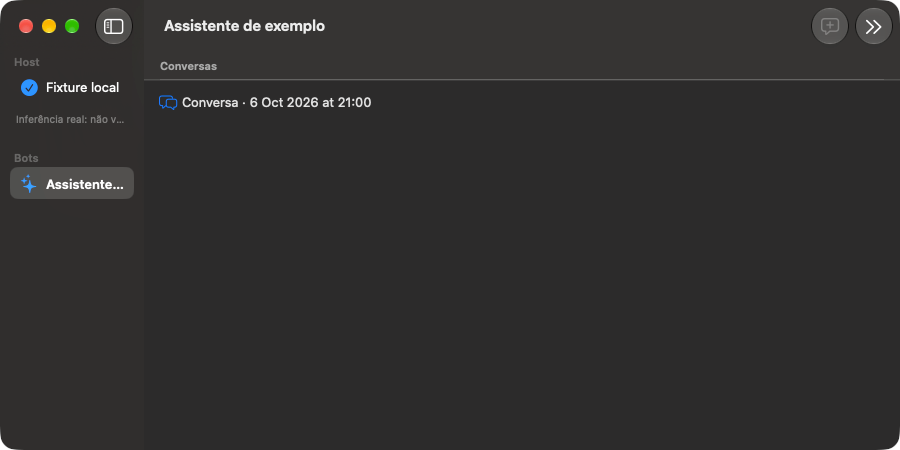
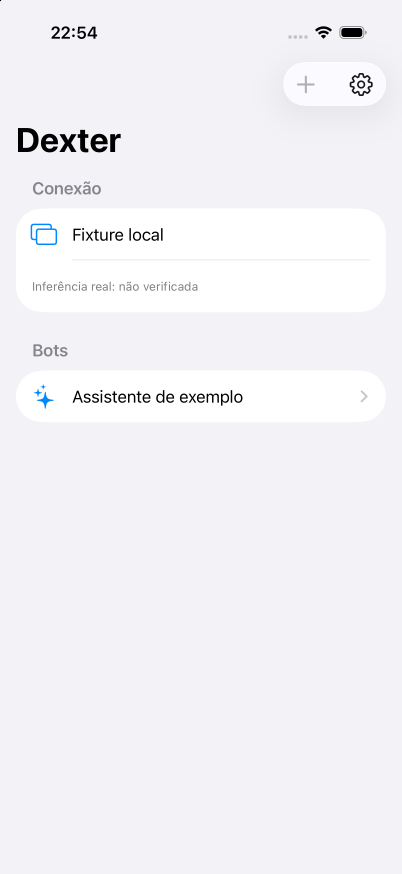
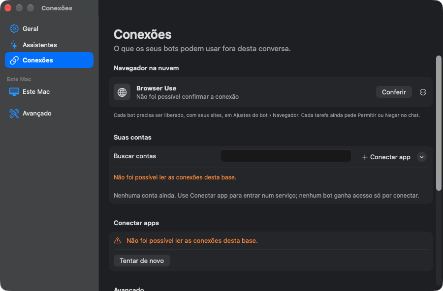
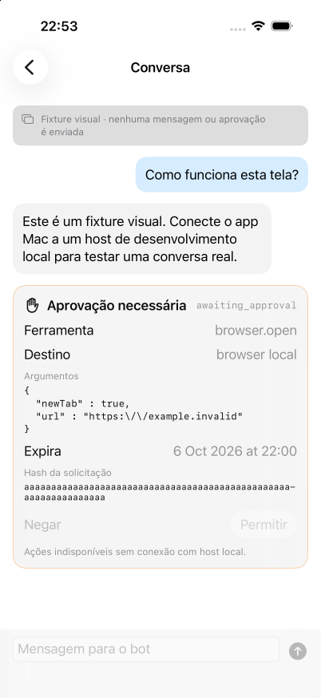
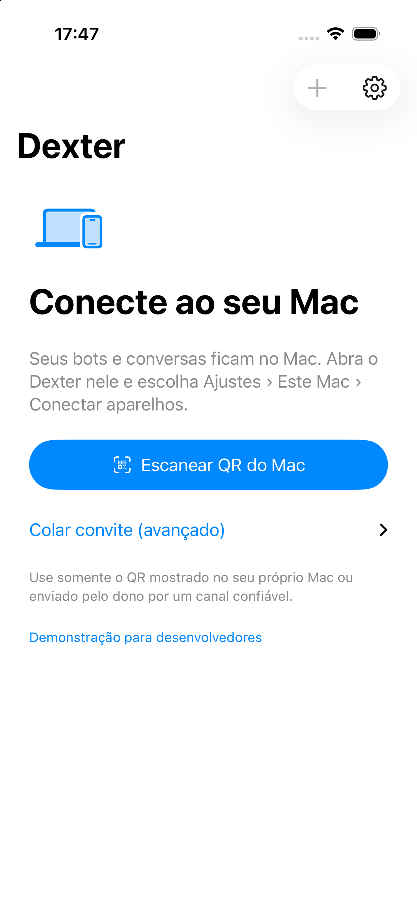

# Dexter Bot auto Test

[Português — como instalar](README.pt-BR.md#como-instalar)

> In the code the product is called **Dexter** (`@dexter/*` packages, `DexterApple.xcodeproj`, bundle ids `com.dexter.bot.mac` / `com.dexter.bot.ios`).

## Install

**There is currently no downloadable binary, DMG, PKG, IPA, App Store or TestFlight release.** This repository shares the experiment's source code. The [Releases page](https://github.com/gavasques/my-dexter-bot/releases) has no published installer; downloading the source ZIP does not install the app.

### Build the local host

Requires a Mac for the Apple apps, Node.js `>=24.14.0 <25`, pnpm `11.0.9`, Git, and full Xcode with Swift 6 support.

```sh
git clone https://github.com/gavasques/my-dexter-bot.git
cd my-dexter-bot
npm install --global pnpm@11.0.9
pnpm install --frozen-lockfile
pnpm build
pnpm dexter serve --data-dir .dexter --port 4317
```

Keep that terminal open while using the local host. The CLI is run from this checkout; it is not a standalone binary. For real model responses, install and sign in to the official Claude/Codex CLIs separately, then use the opt-in engine flags in [Build and run](#build-and-run). Never share your `.dexter/` data directory or CLI credentials.

### Run the Mac app (macOS 14+)

1. Open `apps/apple/DexterApple.xcodeproj` in Xcode.
2. Select the **DexterMac** scheme and **My Mac** destination.
3. In **Signing & Capabilities**, select your own development team if Xcode requires signing. No team or signing certificate is supplied.
4. Choose **Product → Run**. For the manually started host, use **Use local host** with `http://127.0.0.1:4317` in the app settings.
5. To keep your own build, find **Dexter.app** in Xcode's Products group, choose **Show in Finder**, and copy it to **Applications**. Keep this repository and its built host available; copying the app does not package Node, the host, or the engine CLIs.

This is a local development build, not a signed/notarized installer for distribution. If macOS rejects a downloaded app, do not disable Gatekeeper or remove quarantine indiscriminately; build from source instead.

### Run on iPhone (iOS 17+)

Select **DexterIOS** in Xcode, connect your iPhone, choose it as the destination, configure your own signing team, and choose **Product → Run**. Follow Apple's device trust and Developer Mode prompts if requested. Development signing may require periodic rebuilding. There is no distributable IPA or TestFlight link.

An iPhone needs pairing with the Mac; `127.0.0.1` on the phone refers to the phone itself. Use the pairing flow in the app rather than exposing port 4317 to the internet.

## Background

This was a test of Grok Bot orchestrating actions inside T3 Code on my VPS. The agents could choose between Claude and Codex, capped at Opus 5.5 and Sol 6.1. Astra and Fable were not allowed. It took 64 hours of autonomous work, with many back-and-forths and many wrong decisions. In the end they reached something functional: a desktop app for Mac and an app for iOS.

It is published as-is, as an experiment. It is not a maintained product.

## Disclaimer

This system was created by Grok Bot orchestrating Claude and Codex. The code was generated by AI agents.

- We do not know where all of the code comes from. The models may have reproduced snippets of existing code that is protected by copyright or covered by another license.
- We take no responsibility for copies, forks, redistribution or any other use of this code, including any copyright or license infringement. If you reuse any part of it, checking rights and licenses is your responsibility.
- It is provided "as is", without warranty of any kind (see `LICENSE`).
- It is only an example of what is possible to build with AI agents. It is not a product or a reference implementation.

If you hold rights to any code in this repository and want it removed or attributed, contact the repository owner on GitHub.

## Contributions

This project is not maintained and will not be followed up. Pull requests, issues and feature requests are not accepted. Fork it if you want to build on it.

## Screenshots

| Mac | iOS |
|---|---|
|  |  |
|  |  |
| |  |

## Stack

**Monorepo:** pnpm workspace (`pnpm@11.0.9`), Node `>=24.14.0 <25`, TypeScript 5.9 (ESM, `tsc -b` project references).

```
apps/
  apple/      SwiftUI clients (macOS + iOS) and local Swift packages
packages/
  hub/                 authority, bots, teams, conversations, turn runtime (Hono HTTP API)
  engines/             engine drivers: Claude CLI, Codex app-server, ACP and other adapters
  gateway/             per-turn tool gateway (MCP): permissions, review, receipts
  connectors/          MCP client/import (@modelcontextprotocol/client, ajv, re2-wasm)
  connections-service/ connection configuration service (Hono)
  context/             documents, memory, skills, versioned artifacts, operational manuals
  contracts/           shared zod schemas
  cli/                 `dexter` CLI / host server (@hono/node-server)
  agenda/              scheduling (croner)
  devices/ relay/ relay-host/ relay-service/ relay-consumer/   device pairing and a restricted message relay
  operations/          operation validation/review
ops/local-host/        launcher, preflight and a systemd unit example
third_party/NoodleVoice/  Apache-2.0 license and notice for the adapted voice code
tests/                 node:test suites and fixtures
```

Architecture overview (in Portuguese): [docs/architecture.md](docs/architecture.md).

**Storage:** SQLite through Node's built-in `node:sqlite` (`DatabaseSync`). Data lives in a data directory (e.g. `.dexter/`).

**Transport:** an HTTP API on loopback (Hono); paired devices go through the relay packages, which accept only a restricted set of messages. It is not a general remote-tool transport.

**Engines:** the official `claude` and `codex` CLIs, installed and logged in by the user. They are opt-in and passed by absolute path.

**Apple apps:** SwiftUI, Swift 6 language mode (swift-tools 6.0). Xcode project `apps/apple/DexterApple.xcodeproj` (also `Project.yml`). Two app targets, macOS 14+ and iOS 17+. Local packages: DexterAppCore, DexterHostClient, ClientIdentity, DeviceIdentity, KeychainRuntime (macOS), AssistantRuntimeSetup (macOS), Capabilities, MacCapabilities, NativeActions.

## Build and run

```sh
pnpm install --frozen-lockfile
pnpm build
pnpm dexter help
pnpm dexter serve --data-dir .dexter --port 4317
# with engines:
pnpm dexter serve --data-dir .dexter --port 4317 --enable-engines \
  --claude-command /abs/path/claude --codex-command /abs/path/codex [--enable-mcp]
```

To build the Apple apps, open `apps/apple/DexterApple.xcodeproj` in a full Xcode install. Set your own signing team. None is committed.

## Tests

```sh
pnpm typecheck
node scripts/check-markdown-links.mjs
```

`pnpm test` (the full aggregate) needs macOS, Xcode, prepared fixtures, and a Chrome for Testing build allowed through `DEXTER_REAL_BROWSER`. It is not a portable Linux suite.

## Limitations

- Experimental. The only setup that has been observed working is a local install on a Mac.
- A cloud or VPS host, remote Mac jobs, signing/notarization and distribution are not validated.
- There is no OS sandbox: approved shell and local MCP processes run with the host user's permissions.
- Cancelling a task does not prove that its effects were reverted.
- Most code comments are in Portuguese.

## License

0BSD (see `LICENSE`). Third-party components keep their own licenses (see `THIRD_PARTY_NOTICES.md`).
